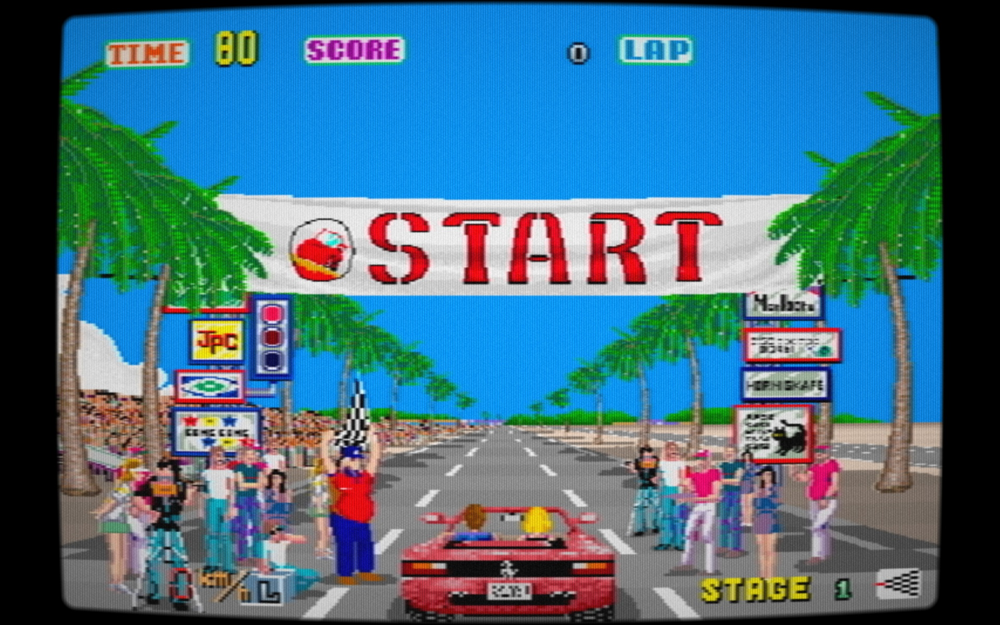

# CannonBall-SE

**OutRun, as you remember it — not as an LCD renders it.**

A fork of Chris White's [CannonBall](https://github.com/djyt/cannonball) engine, built for
home-made arcade cabinets. It puts the picture back through a CRT: soft edges, bleeding colour,
curved glass, a shadow mask and a hint of analogue noise. And it runs at 60fps on a Raspberry Pi.



---

Modern displays render OutRun's low-res graphics as oversized, razor-sharp pixels, and the game
ends up looking clinical. CannonBall-SE fixes that with a two-stage filter — an NTSC filter on the
CPU, then a CRT shader on the GPU. Press **F8** in game to flip between the two and see the
difference.

It also gives you:

- **Full speed on modest hardware.** Multi-threaded, with automatic frame-rate control, so the
  game never runs slow — it drops frames instead.
- **Audio that behaves.** Rewritten from scratch: arcade-accurate playback speed, no stutters or
  sync pops, and your own music from WAV, MP3 or YM files.
- **Cabinet-ready.** Force feedback, rumble on skids, machine-hours tracking, and hardware
  watchdog integration so a hung cabinet reboots itself.
- **Bug fixes.** Consistent wheel slip through stage transitions, no phantom cars at checkpoints,
  plus everything fixed in the original.

---

## Try it

**Linux or Raspberry Pi** — needs Raspberry Pi OS Bookworm or newer, or Ubuntu 24.04+:

```bash
git clone https://github.com/J1mbo/cannonball-se.git
cd cannonball-se
./install.sh          # installs dependencies, builds, sets permissions
# copy your OutRun revision B ROMs into ./roms
build/cannonball-se
```

`install.sh` asks a couple of questions, wants `sudo`, and changes your group membership — so
**reboot before the first run**. A few minutes on a Pi 4 or a PC; 40+ minutes on a Pi Zero, but
unattended.

**Windows** — [download the executable](https://github.com/J1mbo/cannonball-se/releases/latest),
or clone it in Visual Studio 2026 and let the CMake integration do the rest (allow ~20 minutes
the first time, while it fetches dependencies).

Either way you'll need your own copy of the **OutRun revision B** ROM set, which is not included
and never will be. Drop the files in `roms/` — [roms/roms.txt](roms/roms.txt) lists them. A MAME
`outrun.zip` dropped into `roms/` unextracted also works. You are expected to own the originals.

Full instructions, including a manual build: **[docs/INSTALL.md](docs/INSTALL.md)**.

## Will it run on my board?

**60fps on every quad-core Raspberry Pi. 30fps on the single-core boards.** On a Pi 2 or Pi 3 you
may need the fast shader or a small GPU clock bump to get there; a Pi 4, Pi 5 or any modern PC
manages it at stock.

Don't take our word for it — `build/cannonball-se -perftest` measures what your own board sustains.

If you're short of frames, the two settings that matter most are `video.hires` (CPU) and
`video.shader_mode` (GPU). **[docs/PERFORMANCE-TUNING.md](docs/PERFORMANCE-TUNING.md)** has the
board-by-board table, the clock recipes, and how to tell which one is holding you back.

## Playing

Press **C** for a coin and **S** to start. Steer with the arrow keys, `A` to accelerate, `Z` to
brake. Everything is remappable, and USB wheels, pedals and gamepads all work.

**[docs/PLAYING.md](docs/PLAYING.md)** covers the full controls, the function keys, wheel setup
and how to add your own music.

## Documentation

| | |
|---|---|
| [Install](docs/INSTALL.md) | Building on Linux, Raspberry Pi and Windows |
| [Playing](docs/PLAYING.md) | Controls, wheels, custom music |
| [Performance tuning](docs/PERFORMANCE-TUNING.md) | Getting to 60fps on your board |
| [Configuration](docs/CONFIGURATION.md) | Every setting in `config.xml` |
| [Screen filters](docs/SCREEN-FILTERS.md) | What the CRT pipeline actually does |
| [Troubleshooting](docs/TROUBLESHOOTING.md) | Audio, controllers, video |
| [Changelog](CHANGELOG) | Release history |

Engineering notes on the renderers, filters and benchmarks live in [tools/](tools/).

## Licence and credits

Free to use and share, but not to sell. The upstream CannonBall terms apply
([docs/license.txt](docs/license.txt)) alongside this fork's additional terms
([docs/CannonBall-SE-license.txt](docs/CannonBall-SE-license.txt)); third-party components are
listed in [docs/THIRD-PARTY-NOTICES.md](docs/THIRD-PARTY-NOTICES.md).

Original engine by **Chris White**. NTSC filter library by **Shay Green** ('Blargg').
CannonBall-SE by **James Pearce**.

*OutRun is a trademark of SEGA Corporation. This project is not affiliated with SEGA.*

Bugs and suggestions: <https://github.com/J1mbo/cannonball-se/issues>
